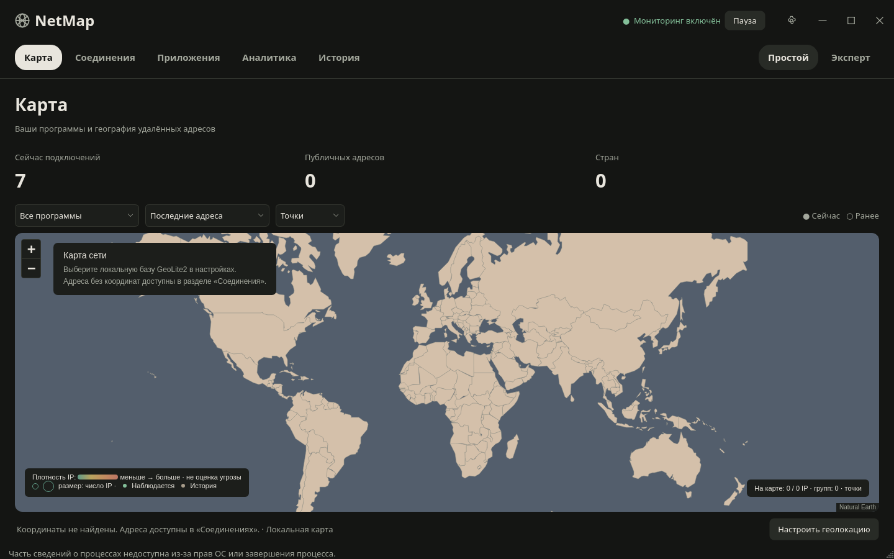

# NetMap 0.3 — Interaction & Map UX

Настольное приложение на Python 3.12 и PySide6 для локального наблюдения за
сетевыми соединениями Windows 10/11. Интерфейс на русском языке, тёмная тема,
большая интерактивная карта, собственная рамка окна, горизонтальная навигация,
Atlas Dark / Atlas Light и режимы «Простой» / «Эксперт».

Это функциональный MVP. Программа получает реальные сокеты через psutil,
сопоставляет процессы, сохраняет локальную историю и использует только
координаты локальной геолокационной базы. Демонстрационных соединений,
вымышленных скоростей и автоматических проверок удалённых серверов нет.



## Запуск на Windows 10/11

Нужны 64-битная Windows и 64-битный Python 3.12+ с python.org.
Из PowerShell в папке проекта:

```powershell
py -3.12 -m venv .venv
.\.venv\Scripts\python.exe -m pip install -e ".[dev]"
.\.venv\Scripts\python.exe -m netmap
```

Активация окружения и изменение ExecutionPolicy не требуются. Дополнительный
вариант: `powershell -File scripts/run.ps1`, если ваша политика разрешает запуск
локальных PowerShell-скриптов. Запускать от администратора обычно не нужно.

При первом запуске мониторинг включён, интервал опроса — 2 секунды.
Сведения, недоступные из-за прав Windows, отмечаются в интерфейсе.
На карте без базы GeoLite2 не будет точек: адреса остаются в таблице.
Офлайн-карта мира доступна сразу.

## Новое в 0.3

[Функции, проверки и ограничения](docs/NETMAP_0.3.md) ·
[сравнение производительности карты](docs/MAP_PERFORMANCE_0.3.md) ·
[список изменённых файлов](docs/CHANGED_FILES_0.3.md).

«Соединения» исследуют серверы → программы → отдельные сокеты.
«Приложения» показывают отдельный профиль с географией, протоколами,
сгруппированной историей и избранным. Добавлены SVG-кнопки окна,
единая типографика, состояния hover / focus / pressed, общая карточка IP,
плотность уникальных IP, поиск Ctrl+K и список новых адресов за период.
Экспертные фильтры PID, состояния, протокола, приложения и IPv4/IPv6
работают одновременно; несколько выделенных строк можно экспортировать в CSV.

Карта сохраняет объекты и центр, откладывает обновления при перемещении,
кэширует геометрию кластеров и пропускает ненужную отрисовку. Цвет плотности
не означает опасность. Наблюдения и схема SQLite прежних версий сохраняются.

Для обновления исходников закройте приложение и выполните:

```powershell
git fetch origin
git switch netmap-0.3
git pull --ff-only
.\.venv\Scripts\python.exe -m pip install -e ".[dev]"
.\.venv\Scripts\python.exe -m netmap
```

## Разделы

- **Карта**: локальные контуры стран, масштабирование и перемещение, точки
  публичных IP, группы близких точек, карточки нескольких процессов на одном IP,
  фильтр приложения, различие текущих и ранее обнаруженных адресов. Исходная
  точка задаётся вручную. Линии ограничены 80 группами, адреса — 100/500/1000.
- **Соединения**: реальный TCP и UDP, PID, процесс, адреса, порты, состояние,
  страна, время; поиск, сортировка, фильтры, подробности и копирование IP.
  Обновление сохраняет выбор оставшейся строки, фильтр и прокрутку.
- **Приложения**: реальные имена, доступные системные иконки исполняемых файлов,
  сокеты, уникальные удалённые IP, география, серверы и последние сеансы приложения.
- **Аналитика**: выбранный период: 15 минут, час, день или история, число новых наблюдений, приложения,
  протоколы, страны по уникальным публичным IP; ручная TCP-диагностика и её история.
- **История**: SQLite, поиск по процессу/IP, период, подробности сеанса,
  постраничная выборка по 100 строк и очистка с подтверждением.
- **Настройки**: интервал, запуск мониторинга при открытии, эффекты карты,
  лимит адресов, база MMDB, срок хранения, исходная точка, онлайн-тайлы,
  разрешение диагностики, число попыток и TCP-таймаут.

Кнопка «Пауза» полностью останавливает сбор. Таблица сохраняет последний снимок
с видимым сообщением об остановке; карта очищает текущие точки. Возобновление
создаёт новые сеансы наблюдения. После сна или длительного разрыва опросов
программа также начинает новые сеансы, не предполагая непрерывность соединений.

## Геолокация

1. Зарегистрируйтесь на [MaxMind](https://www.maxmind.com/en/geolite2/signup).
2. Примите актуальные условия GeoLite2 и скачайте **GeoLite2 City**, формат MMDB,
   в личном кабинете MaxMind. Распакуйте `GeoLite2-City.mmdb` в локальную папку.
3. В «Настройках» выберите файл и сохраните изменения.
4. Обновляйте базу официальными средствами MaxMind, например `geoipupdate`,
   с соблюдением сроков обновления и условий использования. После замены файла
   перезапустите приложение, чтобы заново открыть базу и очистить кэш.

База не распространяется в проекте и не скачивается скрыто. Ключи MaxMind
не нужны приложению, их не следует сохранять в Git. IPv4/IPv6 обрабатываются
локально; частные, loopback, link-local, multicast и служебные адреса не
отображаются на карте. Неизвестная страна и отсутствующие координаты —
допустимые состояния, а не повод придумывать географию. Геолокация приблизительная:
она может соответствовать офису провайдера, VPN или точке регистрации сети.

## Диагностика и ограничения измерений

Проверка запускается вручную в «Аналитике». Она открывает TCP-соединение к
выбранному адресу и порту, сразу закрывает сокет и показывает минимум,
среднее, максимум времени установления соединения и долю неудачных попыток.
DNS разрешается один раз; проверяется первый адрес, возвращённый системой.
Разрешение DNS не входит в измеренное время TCP. Результаты хранятся локально.
Остановка учитывается между попытками; текущая TCP-попытка ограничена таймаутом.
Ожидание DNS тоже ограничено. Один незавершённый системный DNS-запрос может
доработать в отдельном daemon-потоке; новые DNS-проверки до его завершения отклоняются.

**ICMP-пинг в этой версии не реализован.** Время TCP не является ICMP RTT,
а доля неудачных TCP-соединений не является потерями пакетов. Закрытый порт,
фаервол и DNS могут влиять на результат. Пакеты не перехватываются,
скорости и объёмы трафика отдельных процессов не измеряются.

Периодический опрос может пропускать короткие соединения. UDP без удалённого
адреса показан как открытый сокет, а не установленное соединение. «Наблюдается»
в истории означает наличие сокета в последнем снимке, а завершение наблюдения
не доказывает момент его фактического закрытия. Изменение состояния TCP не
создаёт новый сеанс; исчезновение и повторное обнаружение — создают.

## Хранение и приватность

Данные Windows: `%LOCALAPPDATA%\NetMap\`:

- `history.sqlite3` и файлы WAL SQLite;
- `settings.json`;
- `netmap.log` (ротация: до 3 файлов по 512 КБ);
- `netmap.lock` — защита от параллельного открытия одной базы;
- `tile-cache/` — HTTP-кэш внешних тайлов, если они включены.

История содержит адреса, порты и сведения о процессах; это локальные данные,
которые не передаются в облако. Они сохраняются до выбранного срока хранения
(1–365 дней, по умолчанию 30). Очистка доступна с подтверждением. Размер файла
SQLite может сохранять свободные страницы после периодического удаления;
ручная очистка выполняет VACUUM. Активные наблюдения не удаляются по сроку.
Графики и диагностическая история также очищаются по сроку хранения. CSV
экспортируется в выбранную вами папку и не удаляется при очистке базы.

Внешние тайлы **выключены по умолчанию**. Их включение передаёт OpenStreetMap
ваш внешний IP и номера тайлов области просмотра. IP наблюдаемых серверов,
названия процессов и история туда не отправляются. Веб-компонент разрешает
внешние запросы только к `https://tile.openstreetmap.org`, когда включена эта
настройка. Leaflet и контуры стран включены локально. Если тайлы недоступны,
остаётся локальная карта. В облачной среде с ограниченной сетью для этой
необязательной функции потребуется разрешить `tile.openstreetmap.org`.

Для отдельного профиля данных задайте `NETMAP_DATA_DIR` до запуска.
При удалении профиля после закрытия приложения удаляются также настройки и кэш.
В Linux путь по умолчанию: `${XDG_DATA_HOME:-~/.local/share}/netmap`.

## Сборка EXE

Сборка производится **на Windows**, PyInstaller 6.19.0. Linux не создаёт
проверенный Windows EXE.

```powershell
.\.venv\Scripts\python.exe -m pytest -q
.\.venv\Scripts\python.exe -m PyInstaller --noconfirm --clean NetMap.spec
.\dist\NetMap\NetMap.exe
```

Или запустите `scripts/build.ps1`. Распространяйте **всю папку** `dist/NetMap`,
включая Qt DLL, QtWebEngineProcess и ресурсы Chromium. Выбран режим one-folder,
поскольку QtWebEngine требует вспомогательного процесса и ресурсов.
GeoLite2 не включается в EXE. PyInstaller учитывает QtWebEngine штатными hooks.
EXE не подписан: для публичного релиза потребуется собственная подпись и
проверка лицензий Qt/Chromium. См. [сторонние компоненты](docs/THIRD_PARTY.md).

GitHub Actions содержит проверки Linux/Windows и отдельную Windows-сборку с
артефактом `NetMap-Windows`. Workflow подготовлен, но его выполнение на GitHub
не подтверждено этой локальной проверкой.

## Разработка и проверки

```bash
python3.12 -m venv .venv
.venv/bin/python -m pip install -e '.[dev]'
.venv/bin/python -m pytest -q
QT_QPA_PLATFORM=offscreen XDG_CACHE_HOME=/tmp/netmap-cache .venv/bin/python scripts/gui_smoke.py
QT_QPA_PLATFORM=offscreen XDG_CACHE_HOME=/tmp/netmap-cache .venv/bin/python scripts/map_smoke.py
QT_QPA_PLATFORM=offscreen XDG_CACHE_HOME=/tmp/netmap-cache .venv/bin/python scripts/atlas_smoke.py
```

На Windows используйте `.venv\Scripts\python.exe` и соответствующий синтаксис
переменных PowerShell. `gui_smoke.py` всегда использует отдельную папку данных,
проверяет собственные loopback-сокеты, SQLite, Leaflet/WebChannel, паузу,
TCP-диагностику и штатное завершение потоков. `map_smoke.py` использует только
изолированные тестовые точки, проверяя группировку, экранирование HTML,
выбор IP через Qt, лимит объектов и пустое состояние. Тестовые данные никогда
не попадают в производственный мониторинг.

Автоматические тесты проверяют сбор и сопоставление процессов, повторное
использование PID, недоступность прав, IPv4/IPv6, кэш геолокации, историю,
поиск/фильтры, статистику, настройки, TCP-проверки и поведение таблицы.
Результаты текущей среды: [VALIDATION.md](docs/VALIDATION.md).
Обязательная проверка на целевой ОС: [WINDOWS_CHECKLIST.md](docs/WINDOWS_CHECKLIST.md).

## Архитектура

```text
netmap/
  core/          модели, настройки, статистика, фоновые Qt workers
  network/       psutil-сборщик, кэш процессов с проверкой времени создания
  geo/           локальный Reader MMDB и ограниченный LRU-кэш
  database/      SQLite WAL, сеансы, выборки, срок хранения
  diagnostics/   ручные TCP-проверки с ограниченным ожиданием DNS
  ui/            главное окно, рамка, страницы, таблица и QtWebChannel
  widgets/       графики реальных наблюдений через QPainter
  resources/     SVG, ICO, локальный Leaflet и контуры стран
tests/           автоматические тесты
scripts/         запуск, сборка и функциональные GUI-проверки
docs/            ограничения, лицензии и проверка Windows
```

Сбор, геолокация, операции SQLite и диагностика выполняются вне GUI-потока.
GUI получает пакетные снимки через сигналы Qt. История запрашивается с
ограниченной выборкой. Карта получает пакет адресов и объединяет близкие
точки при выбранном масштабе. Полный обзор изменений модулей: [CHANGED_FILES_0.2.md](docs/CHANGED_FILES_0.2.md).

Кэш процессов ограничен текущими PID,
геолокации — 8192 адресами, системных иконок — 256 приложениями.

Этапы MVP: окно/тема/навигация → реальный сбор/таблица → карта/геолокация →
история/аналитика → диагностика/настройки/тесты. Отдельные последующие задачи:
ICMP, более точный событийный сбор Windows ETW, нативный Snap Layouts при
наведении и дополнительные профили оформления.

## Публикация исходников

Проект содержит `.gitignore`, лицензию, инструкции и GitHub Actions.
В Git не должны попадать `.venv`, базы истории, ключи, логи и MMDB.
Перед первым коммитом проверьте `git status` и результаты тестов.
Исходники 0.1 сохранены в `main`, 0.2 — в `netmap-0.2`,
0.3 — в `netmap-0.3`. Публикация релиза и Windows EXE требует целевой проверки.
