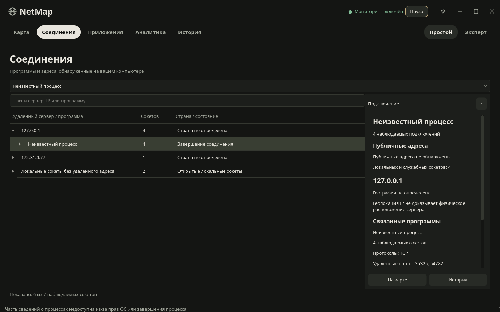
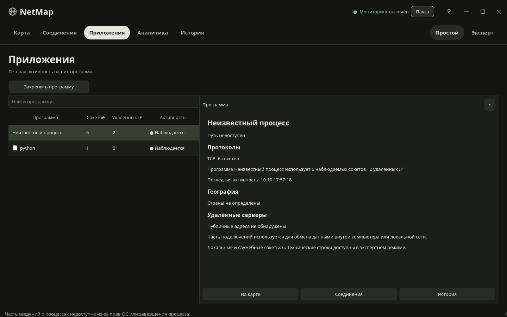

# NetMap 0.3

## Причины и план изменений

В 0.2 ConnectionsPage и AppsPage использовали GroupsView с одинаковой группировкой по программе. ConnectionsPage теперь использует отдельный ConnectionExplorer: сервер → программа → сокеты; AppsPage остаётся центром анализа приложения. UDP без удалённого адреса обозначается открытым сокетом.

P0: connection_explorer.py / connections_page.py — разделить исследования; apps_page.py / groups.py — профиль и список; typography.py / theme.py / interaction.py — шрифты и состояния; window_controls.py / window_frame.py / resources/*.svg — кнопки окна.

P1: map_view.py — очередь передачи; performance.js — отложенная отрисовка; cluster_renderer.js — кэш, плотность и оформление кластеров; map.js — обновление изменённых объектов; ip_details.py — общая карточка; map_page.py — переключатель и действия.

P2: search_overlay.py / worker.py / store.py — асинхронный поиск; settings.py / apps_page.py / groups.py — избранное; analytics_page.py / store.py — новые адреса; main_window.py — переходы.

## Реализовано

- Простой исследователь серверов с раскрываемыми программами и отдельными сокетами, странами, состояниями, доступными системными иконками, поиском и фильтром приложения.
- Экспертная таблица: адреса и порты, TCP/UDP, PID, время; отдельный фильтр семейства IPv4/IPv6, состояния и PID в дополнение к прежним поиску, протоколу и программе. Сортировка, выбор столбцов, копирование технических данных, CSV выбранных строк, сохранение множественного выделения.
- Профиль программы: путь, сокеты, уникальные адреса, география, протоколы, серверы, сгруппированная история и переходы. Повторяющиеся локальные адреса объединены. Избранное сохраняется по executable/app_key, не PID; неактивные закреплённые программы остаются в списке с нулём текущих сокетов.
- SVG WindowControls: реальное сворачивание, максимизация/восстановление и закрытие, смена значка, варианты для обеих тем. Сохранены nativeEvent Windows, drag, double-click, resize и асинхронное завершение операций.
- Шрифт приложения и редакторов: Segoe UI Variable → Segoe UI → доступный системный fallback. QComboBox popup, spin/date editors и меню получают тот же шрифт. Hover, pressed, selected, disabled, keyboard focus и курсор кнопок. Переходы 140 мс применены к HTML-кнопкам карты; неподдерживаемых CSS-анимаций Qt нет.
- Отдельная очередь карты 250 мс, объединение промежуточных снимков, пропуск одинакового JSON, debounce JS 80 мс + requestAnimationFrame. Пока пользователь перемещает карту, данные ждут окончания движения. Масштаб и центр не сбрасываются, fitBounds не вызывается. Геолокационный LRU сохранён.
- Кластеры считают уникальные IP. Четыре спокойных цвета определяются квартилями распределения групп на текущем масштабе; размеры логарифмические, 28–58 px. Tooltip показывает число IP и связанных приложений, click приближает, максимальный масштаб раскрывает адреса. Легенда отделяет плотность от оценки риска.
- «Точки / Плотность»: собственный offline Canvas-слой Leaflet без дополнительной библиотеки. Каждый IP имеет единичный вес; координаты реальные; агрегация по экранным ячейкам зависит от масштаба, перерисовка выполняется после движения. Можно нажать рядом с точкой плотности для открытия IP. Сглаживание визуальное, не измерение трафика.
- Общая IP-карточка карты и исследователя: доступные география, координаты, программы, протоколы, порты, время; copy/map/history/connections. Исторические времена относятся к доступным загруженным наблюдениям. Геолокация не доказывает физическое расположение сервера.
- Ctrl+K: текущие программы/IP плюс результаты SQLite, разделы, история и карта приложения. Debounce 180 мс, запросы в MonitorWorker, устаревшие ответы отбрасываются. Стрелки, Enter, Escape работают.
- «Новые публичные адреса»: выбранный аналитический период, первое наблюдение относительно сохранённой истории, программы, страна, переход на карту. Список ограничен 100 адресами; уведомлений о каждом соединении нет.
- Подсказки объясняют IP, порт, протокол, локальное соединение и прокси без постоянного справочника.

## Сохранность данных

Схема SQLite остаётся user_version=1, миграция не нужна. Сеансы, timestamps и существующие настройки сохраняются. Новые настройки имеют значения по умолчанию; favorites и map_performance сохраняются атомарно прежним механизмом. Сбор, GeoLite2, пауза, TCP-диагностика и SQLite работают в прежних потоках. Дополнительные внешние запросы не введены.

## Проверки

77 тестов: 68 регрессионных и 9 новых. Проверены серверная группировка/UDP, совмещённые фильтры, множественный выбор, реальные действия WindowControls и смена иконки, focus/pressed/disabled/cursor, шрифты редакторов, карточка без вымышленных полей, избранное с неактивной программой, literal SQLite search, клавиатурный поиск и новый IP независимо от числа сокетов.

GUI smoke: реальные собственные TCP-сокеты, сбор, SQLite, QtWebChannel, локальная карта, пауза, TCP-проверки и корректное завершение. Atlas smoke: темы, режимы, минимальный размер, страницы, история, переходы приложения/карты/соединений, избранное и поиск. Map smoke: сохранение маркеров, уникальные IP, кластеры на разных масштабах, плотность, адаптивные цвета/размеры, отложенное обновление и очистка слоёв. Все прошли в Linux offscreen.

Отдельные тестовые координаты существуют только в scripts/map_smoke.py и scripts/map_benchmark.py; приложение их не импортирует. [Замеры и исходные JSON](MAP_PERFORMANCE_0.3.md).

## Ограничения

Windows 10/11, Snap, несколько мониторов, DPI 125–200%, native resize, системные иконки и Windows EXE в этой Linux-среде не проверялись. [Чеклист Windows](WINDOWS_CHECKLIST.md) остаётся обязательным для релиза; CI Windows настроен, его удалённые результаты здесь не подтверждены.

Повторные обновления карты стали дешевле; создание новых объектов не гарантированно ускорилось. Замеры JS не включают GPU paint, FPS, передачу WebChannel или пользовательское перемещение; это не доказательство плавности на Windows. Режим плотности — относительная концентрация отображаемых IP, а не число серверов, объём трафика или риск. Максимум 1000 отображаемых адресов, до 80 линий; исторический набор ограничен прежней выборкой.

Поиск ограничивает результаты (до 30 сохранённых программ и 30 IP, отображение до 20 программ); SQL выполняется в том же рабочем потоке и на большой базе может задержать следующий опрос, не блокируя GUI. История профиля использует последние 100 сеансов. Длительный CSV-экспорт также разделяет поток мониторинга. Список серверов простой страницы перестраивает дерево при опросе с сохранением раскрытых серверов, выбора и прокрутки; он не виртуализирован.

GeoLite2 предоставляется пользователем; нет обратного DNS, определения владельца, ICMP, перехвата пакетов или вымышленных скоростей. Данные о процессах могут быть недоступны из-за прав ОС. Живые тесты под игровой нагрузкой не проводились.

## Снимки с реальными наблюдениями Linux

